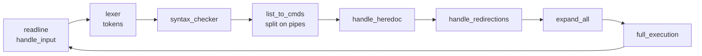
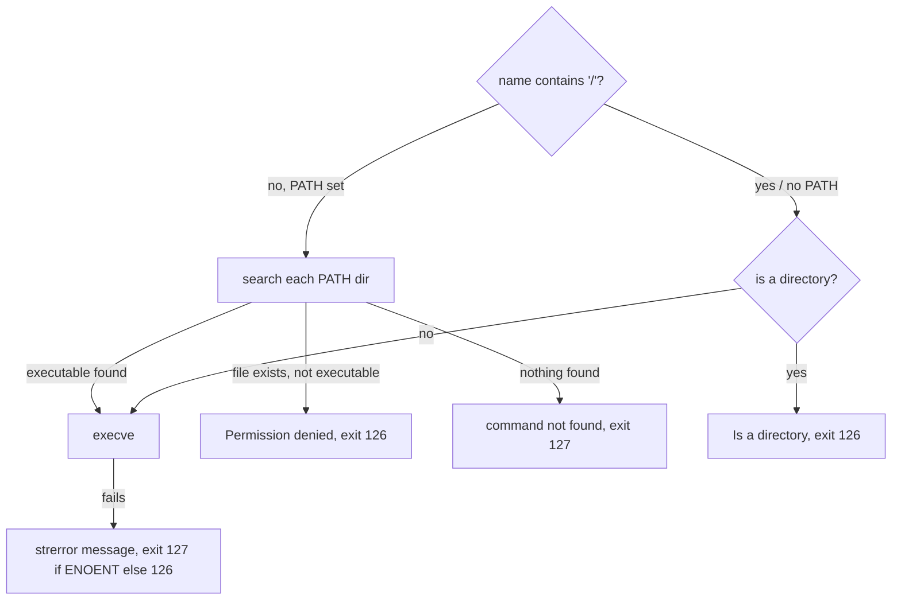

# Architecture

Every input line goes through the same pipeline, driven by the loop in
`src/main.c`:

`parser()` (`src/parsing/parser.c`) runs the stages from the lexer to
`expand_all`; `full_execution()` (`src/exec/execution.c`) runs the result. If
any parser stage fails, the line is dropped and the prompt returns.

## Data structures (`includes/minishell.h`)

- `t_token` — one word or operator: `arg` (string), `type`, `append`, `next`.
  - `type` is one of `DF` (unquoted word), `SQ` (single-quoted), `DQ`
    (double-quoted), `OP` (`<`, `>`, `<<`, `>>`), `PP` (`|`).
  - `append` is set when the token is directly attached to the next one with no
    separator, so `a"b"c` becomes three tokens that are joined back together
    during expansion.
- `t_cmd` — one pipeline stage: its token list, `in_fd` (default 0), `out_fd`
  (default 1), `skip_cmd` (set when a redirection failed), and `next`.
- `t_data` — the single global state (`get_data()`): the duplicated
  environment `env`, the current `cwd`, the raw line, token and command lists,
  `exit_code`, and saved stdin/stdout for builtins.

## 1. Lexer (`lexer.c`, `lexer_utils.c`)

`lexer()` walks the line once and appends tokens to `data->token_list`.
Delimiters are whitespace, `<`, `>`, `|` and quotes. Operators `<<` and `>>`
are recognised as two characters (`|` is always one). A quoted section becomes
one token whose type records the quote kind; the quotes themselves are stripped.
If a quote is never closed, `lexer()` returns that quote character so the syntax
checker can report it. The raw line is freed right after lexing.

## 2. Syntax checker (`syntax_checker.c`)

Rejects, with status 2:

- an unclosed quote (`unexpected EOF while looking for matching ...`),
- a leading `|`,
- an operator or pipe at the end of the line (`near unexpected token
  `newline'`),
- an operator followed by another operator or pipe, or `||`-style pipe pairs.

An empty token list (e.g. a line of only spaces) is also dropped.

## 3. Command splitting (`linked_cmd.c`)

`list_to_cmds()` copies the tokens into one `t_cmd` per `|`-separated segment.
The original flat token list is then freed.

## 4. Heredocs (`heredoc.c`)

`handle_heredoc()` runs before any other redirection, for all commands, so
every heredoc is read before anything executes. For each `<<`:

1. The delimiter is expanded as "no expansion" (`ft_expand_and_join(..., 1, ...)`)
   and `ft_should_expand()` records whether it contained any quotes; a quoted
   delimiter disables expansion of the body.
2. A random file name is generated in `/tmp` from `/dev/urandom`; the file is
   opened once for writing and once for reading, then immediately `unlink`ed.
3. A child process is forked to read lines with `readline("> ")` and write
   them to the file (expanding `$VAR`/`$?` via `mini_expand` when allowed). The
   child exits on the delimiter or EOF; its SIGINT handler closes the file and
   exits with 130.
4. If the parent sees a 130/signal result, the whole line is abandoned.
   Otherwise the read end becomes `cmd->in_fd` — but only if this is the last
   input redirection of the command (`last_in_redirection`), else it is closed.
5. The `<<` and delimiter tokens are removed from the command.

## 5. Redirections (`redirection.c`, `redirection_utils.c`)

`handle_redirections()` scans each command left to right. For every `<`, `>`,
`>>` it expands the target (`ft_expand_and_join`), and:

- zero or more than one word → `ambiguous redirect`, status 1, `skip_cmd = 1`
  (for `<`, `in_fd` becomes -1);
- `open()` failure → system error message, status 1, `skip_cmd = 1`;
- otherwise opens the file (`O_TRUNC` for `>`, `O_APPEND` for `>>`), closing any
  previous output fd so the last one wins. Input files are opened to check they
  exist, and only the last input redirection is kept as `in_fd`.

Redirection operator and target tokens are then removed (`free_appended_nodes`),
leaving only the command words. After the first failure in a command, later
redirections of that command are not processed.

## 6. Expansion (`expand_all.c`, `expand_and_join.c`, `ft_split_whitespace.c`)

`expand_all()` rebuilds each command's token list with
`ft_expand_and_join()`:

- `SQ` tokens are copied literally.
- `DF` and `DQ` tokens go through `mini_expand()`, which replaces each `$NAME`
  (letters, digits, `_`; must not start with a digit) and `$?` using
  `ft_getenv()`. Unset variables become the empty string.
- `DQ` results stay one word. `DF` results are split on whitespace
  (`ft_split_whitespace`), so `$VAR` containing spaces yields several tokens,
  and an empty result yields none.
- Tokens whose `append` flag is set are joined to the following token (with
  special handling so that word splitting at the boundary only splits when the
  expanded text actually starts or ends with whitespace).

Operators and pipes are passed through unchanged. Because heredocs and
redirections have already been consumed, only plain words remain at this point.

## 7. Execution (`exec/`)

`full_execution()`:

- If the line is a **single builtin** with no failed redirection,
  `exec_single_builtin()` saves stdin/stdout with `dup`, applies `in_fd` /
  `out_fd`, runs the builtin in the shell process, then restores the saved fds.
- Otherwise it walks the command list. For each stage `pipe_and_fork()`:
  creates a pipe if there is a next stage, skips commands with `skip_cmd`, and
  forks. `exec_child()` wires up stdio: explicit redirections take priority over
  pipe ends, then runs either a builtin (`do_builtin(..., 1)`, which then calls
  `ft_exit`) or `execute_cmd()`.
- The parent closes pipe ends it no longer needs. It waits for the last command
  to get `$?` (exit status, or `128 + signal`; code 131 prints `Quit (core
  dumped)`), then reaps the remaining children with `wait`.

`execute_cmd()` (`run_cmd.c`) resolves the program:

Just before `execve`, `SIGINT` and `SIGQUIT` are reset to their defaults in the
child, and the child receives a copy of the shell's current `env`.

## Cross-cutting pieces

### Signals (`utils/signals.c`)

`handle_signals()` installs a `SIGINT` handler and ignores `SIGQUIT`. A static
flag from `get_status()` says whether a command is running: at the prompt the
handler clears the Readline line, redraws the prompt and sets `exit_code` to
130; while a command runs it only prints a newline (the child handles the signal
itself). Heredoc children use `heredoc_sig_handler`, which closes the heredoc
file and exits with `128 + sig`.

### Environment (`utils/envirenment.c`, `general.c`)

The environment is a private, heap-allocated `char **` copy of `environ`.
`ft_setenv`, `ft_remvar`, and `remove_var` (unset) edit it; `ft_getenv` returns
a freshly allocated copy of the value (empty string if unset, and the exit code
for `?`). `main` sets `PWD` at start-up and `cd` keeps `PWD`/`OLDPWD` current.

### Memory management (`libft/src/libft/ft_malloc.c`)

Allocations in the shell go through `ft_malloc`, which records every pointer in
a global list; `ft_free` removes it again. `ft_exit()` (in `main.c`) frees the
command list, closes saved fds, releases every allocation still tracked, and
calls `exit`. All exits from the shell and from forked children go through it,
which keeps Valgrind output clean (`make val`).

### Errors (`utils/errors.c`)

`ft_error` .. `ft_error4` concatenate their arguments and write them to
stderr in one call.
